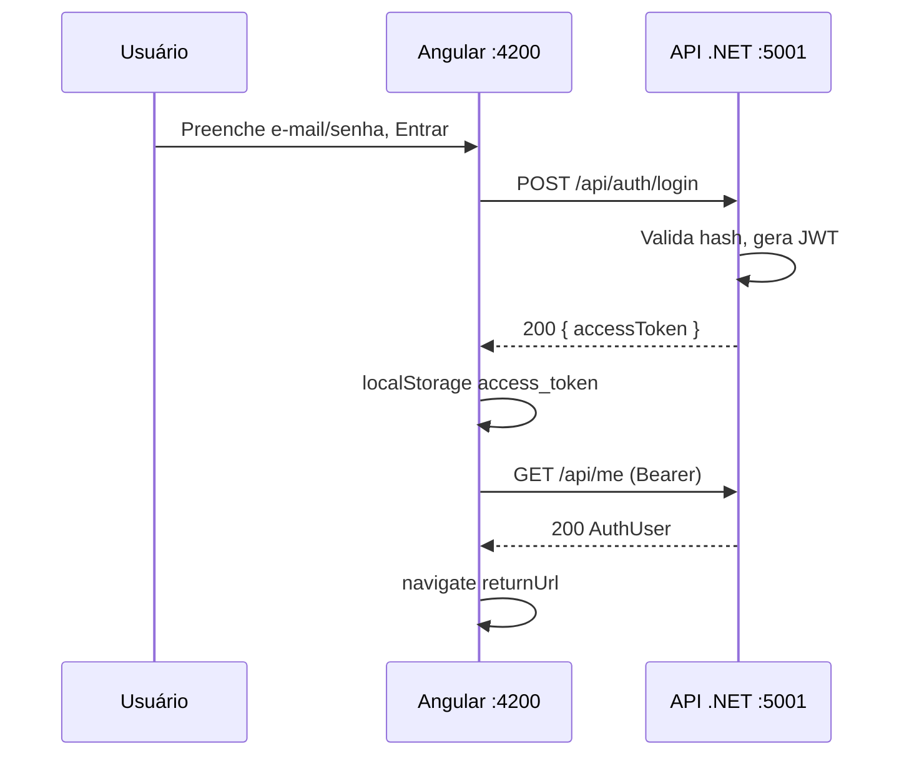
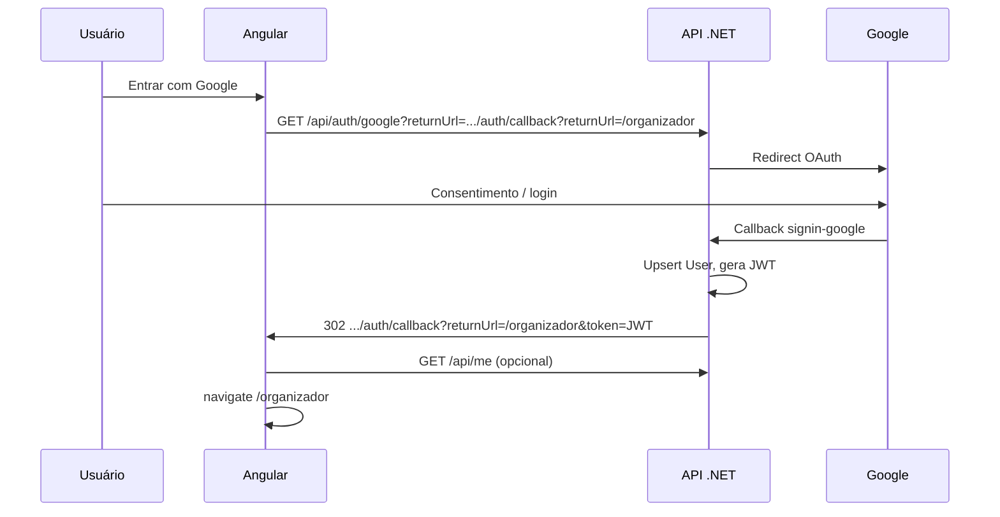

# Contrato de autenticação — Backend .NET ↔ Front Angular

Documento para orientar o desenvolvimento da **API .NET** de autenticação, alinhada ao front **`front-plataforma-esporte`** (Angular 18).  
Objetivo: implementar **login com Google (OAuth 2.0)** e **login com e-mail e senha**, emitindo **JWT da plataforma** consumido pelo SPA.

---

## 1. Contexto do produto

- Plataforma de **inscrição em eventos esportivos** (corrida, natação, etc.).
- Dois perfis de usuário (podem coexistir na mesma conta):
  - **`Organizer`** — área `/organizador` (criar eventos, lotes, inscritos).
  - **`Athlete`** — inscrição em eventos, pagamento (futuro).
- **Organizador e atleta** precisam estar autenticados para fluxos restritos.
- Página pública do evento (futuro) pode ser lida sem login; inscrição exige login.

**Repositório front (referência):** `front-plataforma-esporte`  
**Arquivos-chave no front:**

| Arquivo | Função |
|---------|--------|
| `src/app/core/auth/auth.service.ts` | Orquestra login Google, e-mail/senha, sessão |
| `src/app/core/auth/auth-api.service.ts` | Chamadas HTTP à API |
| `src/app/features/auth/auth-callback/auth-callback.component.ts` | Recebe redirect pós-Google |
| `src/app/core/interceptors/auth.interceptor.ts` | Envia `Authorization: Bearer` |
| `src/app/core/guards/organizer.guard.ts` | Exige role `Organizer` em `/organizador` |
| `src/environments/environment.development.ts` | `apiUrl`, paths, `useAuthMock` |

---

## 2. Configuração esperada no front (ambientes)

### Desenvolvimento (`environment.development.ts`)

```typescript
{
  production: false,
  apiUrl: 'https://localhost:5001',      // URL base da API (sem barra final)
  googleAuthPath: '/api/auth/google',
  credentialsLoginPath: '/api/auth/login',
  useAuthMock: true   // true = front NÃO chama API; false = integração real
}
```

### Produção

```typescript
{
  apiUrl: 'https://api.plataforma-esporte.com',  // ajustar domínio real
  googleAuthPath: '/api/auth/google',
  credentialsLoginPath: '/api/auth/login',
  useAuthMock: false
}
```

**Para integrar:** backend rodando + front com `useAuthMock: false` + CORS liberando `http://localhost:4200`.

---

## 3. Princípios que o backend deve seguir

1. **JWT é sempre da plataforma**, não o access token bruto do Google.
2. **Client Secret do Google** apenas no servidor (variável de ambiente / Key Vault).
3. **Mesma tabela de usuários** para login Google e e-mail/senha; vincular pelo **e-mail** quando fizer sentido.
4. **Roles** explícitas: `Organizer`, `Athlete` (strings exatas, case-sensitive).
5. Endpoints protegidos validam JWT (`Authorization: Bearer`).
6. Erros de validação/login: preferir **RFC 7807 Problem Details** (`application/problem+json`); o front hoje trata falha genérica no login, mas evolução prevista.

---

## 4. Modelo de dados sugerido (API)

### Entidade `User`

| Campo | Tipo | Observação |
|-------|------|------------|
| `Id` | `Guid` | PK; claim JWT `sub` |
| `Email` | `string` | Único, normalizado (lower) |
| `Name` | `string` | |
| `PictureUrl` | `string?` | URL foto (Google) |
| `GoogleSubjectId` | `string?` | `sub` do Google; único quando preenchido |
| `PasswordHash` | `string?` | Null se só Google; ASP.NET Identity hasher |
| `CreatedAt` | `DateTime` | UTC |
| `UpdatedAt` | `DateTime` | UTC |

### Papéis (`UserRole`)

| Valor | Uso |
|-------|-----|
| `Organizer` | Acesso `/organizador` |
| `Athlete` | Inscrição em eventos |

Implementação sugerida: tabela `UserRoles` (N:N) ou claims no JWT + tabela de vínculo.

**Regra de negócio (MVP):** ao criar usuário via Google, definir política de role inicial (ex.: só `Athlete`; `Organizer` via seed/admin ou flag no banco).

---

## 5. JWT da plataforma — requisitos

### Header em todas as requisições autenticadas (front)

```http
Authorization: Bearer <accessToken>
```

O interceptor **não** envia header se o token começar com `dev-mock.` (apenas mock local do front).

### Claims mínimas no payload

| Claim | Obrigatório | Exemplo |
|-------|-------------|---------|
| `sub` | Sim | GUID do usuário (`Id`) |
| `email` | Sim | `usuario@gmail.com` |
| `name` | Recomendado | Nome exibido |
| `picture` | Opcional | URL da foto |
| `role` **ou** `roles` | Sim | Ver abaixo |

### Formato de roles no JWT

O front aceita **qualquer um** dos formatos:

```json
"roles": ["Organizer", "Athlete"]
```

```json
"role": "Organizer"
```

```json
"role": ["Organizer", "Athlete"]
```

**Valores válidos (exatos):** `Organizer`, `Athlete`.

### Configuração sugerida (.NET)

- Algoritmo: **HS256** (dev) ou **RS256** (prod).
- `Issuer`, `Audience`, `SigningKey` em configuração.
- Expiração recomendada: **60 minutos** (refresh token opcional em fase 2).
- Validar `iss`, `aud`, `exp` em `[Authorize]`.

---

## 6. Endpoints obrigatórios

Base URL exemplo: `https://localhost:5001`

### 6.1 `POST /api/auth/login` — E-mail e senha

**Request** (`application/json`):

```json
{
  "email": "usuario@exemplo.com",
  "password": "SenhaForte@123"
}
```

- Front envia `email` já com `.trim()`.
- Senha: validar no backend (Identity).

**Response `200 OK`:**

```json
{
  "accessToken": "<jwt-da-plataforma>"
}
```

**Response `401 Unauthorized`** — credenciais inválidas:

```json
{
  "type": "https://tools.ietf.org/html/rfc7231#section-6.5.1",
  "title": "Unauthorized",
  "status": 401,
  "detail": "E-mail ou senha inválidos."
}
```

**Response `400 Bad Request`** — validação (campos vazios, e-mail inválido).

**Fluxo no front após 200:**

1. Salva `accessToken` em `localStorage` (`access_token`).
2. Chama `GET /api/me` (ou decodifica JWT como fallback).
3. Redireciona para `returnUrl` (ex.: `/organizador`).
4. Se `returnUrl` começa com `/organizador` e usuário **não** tem `Organizer`, redireciona para `/` com `?accessDenied=organizer`.

---

### 6.2 `GET /api/auth/google` — Iniciar login Google

**Query parameters:**

| Parâmetro | Obrigatório | Descrição |
|-----------|-------------|-----------|
| `returnUrl` | Sim | URL **completa** para onde a API deve redirecionar o browser **após sucesso**, com o JWT |

**Exemplo de chamada gerada pelo front:**

```http
GET /api/auth/google?returnUrl=https%3A%2F%2Flocalhost%3A4200%2Fauth%2Fcallback%3FreturnUrl%3D%252Forganizador
```

Decodificado, `returnUrl` =:

```text
http://localhost:4200/auth/callback?returnUrl=/organizador
```

**Comportamento esperado da API:**

1. Validar que `returnUrl` pertence à **allowlist** de origens do front (anti open-redirect):
   - Dev: `http://localhost:4200`
   - Prod: domínio real do SPA
2. Iniciar challenge OAuth Google (ASP.NET Core `AddGoogle`).
3. Após sucesso do Google:
   - Upsert usuário por `GoogleSubjectId` / e-mail.
   - Emitir JWT da plataforma.
   - **Redirect HTTP 302** para:

```text
{returnUrl}&token={accessToken}
```

Ou seja, resultado final típico:

```text
http://localhost:4200/auth/callback?returnUrl=/organizador&token=eyJhbGciOi...
```

**Em caso de erro no OAuth**, redirecionar para:

```text
http://localhost:4200/auth/callback?returnUrl=/organizador&error=access_denied
```

(O front, sem `token`, manda o usuário de volta para `/auth/login` com `error` na query.)

**Importante:** o **redirect URI registrado no Google Cloud Console** é o da **API**, não o do Angular. Exemplo com handler padrão:

```text
https://localhost:5001/signin-google
```

(ou path customizado — deve coincidir com `CallbackPath` no `AddGoogle`.)

---

### 6.3 `GET /api/me` — Usuário autenticado

**Headers:**

```http
Authorization: Bearer <accessToken>
```

**Response `200 OK`:**

```json
{
  "id": "3fa85f64-5717-4562-b3fc-2c963f66afa6",
  "email": "usuario@gmail.com",
  "name": "Nome do Usuário",
  "pictureUrl": "https://lh3.googleusercontent.com/...",
  "roles": ["Organizer", "Athlete"]
}
```

| Campo | Tipo | Front (`AuthUser`) |
|-------|------|---------------------|
| `id` | `string` (GUID) | `id` |
| `email` | `string` | `email` |
| `name` | `string` | `name` |
| `pictureUrl` | `string \| null` | `pictureUrl` |
| `roles` | `string[]` | `roles` — valores `Organizer` \| `Athlete` |

**Response `401`** — token ausente, expirado ou inválido → front limpa sessão.

**Fallback do front:** se `GET /api/me` falhar após login, tenta montar usuário decodificando o JWT (`sub`, `email`, `name`, `picture`, `roles`/`role`).

---

## 7. Fluxos (diagramas)

### 7.1 E-mail e senha



### 7.2 Google OAuth



---

## 8. Google Cloud Console (checklist backend/devops)

1. Criar projeto e **OAuth 2.0 Client ID** (tipo **Aplicativo da Web**).
2. **URIs de redirecionamento autorizados:** callback da API (ex. `https://localhost:5001/signin-google`).
3. **Origens JavaScript autorizadas (opcional):** `http://localhost:4200`.
4. Tela de consentimento em modo **Teste** + usuários teste, até publicar app.
5. Guardar `ClientId` e `ClientSecret` em `appsettings.Development.json` ou User Secrets — **nunca** commitar secret.

### `appsettings.Development.json` (exemplo)

```json
{
  "Authentication": {
    "Google": {
      "ClientId": "xxx.apps.googleusercontent.com",
      "ClientSecret": "xxx"
    },
    "Jwt": {
      "Issuer": "https://localhost:5001",
      "Audience": "front-plataforma-esporte",
      "SigningKey": "DEV_ONLY_min_32_chars_random_string",
      "ExpirationMinutes": 60
    }
  },
  "Frontend": {
    "AllowedOrigins": ["http://localhost:4200"],
    "CallbackPath": "/auth/callback"
  }
}
```

---

## 9. CORS

Liberar o origin do SPA:

| Ambiente | Origin |
|----------|--------|
| Dev | `http://localhost:4200` |
| Prod | `https://<dominio-front>` |

Métodos: `GET`, `POST`, `PUT`, `PATCH`, `DELETE`, `OPTIONS`.  
Headers: `Authorization`, `Content-Type`.

Com autenticação **Bearer em header**, cookies cross-site em geral **não** são necessários.

---

## 10. Rotas do front que interagem com a API

| Rota front | Uso |
|------------|-----|
| `/auth/login` | Formulário e-mail/senha + botão Google |
| `/auth/callback` | Recebe `?token=` ou `?error=` após Google |
| `/organizador/**` | Exige JWT + role `Organizer` |

**Query `returnUrl` no login:** path interno do Angular (ex. `/organizador`), passado ao fluxo Google aninhado no `returnUrl` do callback.

---

## 11. Segurança — requisitos mínimos

- [ ] Hash de senha: `PasswordHasher<TUser>` (Identity) ou Argon2/bcrypt.
- [ ] Rate limiting em `POST /api/auth/login` (anti brute force).
- [ ] Validar allowlist de `returnUrl` no fluxo Google (evitar open redirect).
- [ ] HTTPS em dev (`dotnet dev-certs https --trust`).
- [ ] Não expor se o e-mail existe em mensagens diferentes (login genérico “e-mail ou senha inválidos”).
- [ ] JWT com expiração curta; refresh token em fase posterior se necessário.
- [ ] Logout: hoje é **só client-side** (front apaga token). Opcional futuro: `POST /api/auth/logout` com blocklist de `jti`.

---

## 12. Registro de novos usuários (e-mail/senha)

O front **ainda não** tem tela de cadastro. Para o MVP backend, definir uma das opções:

| Opção | Descrição |
|-------|-----------|
| A | `POST /api/auth/register` (futuro) — documentar quando existir |
| B | Apenas admin/seed cria organizadores; atletas se registram depois |
| C | Primeiro login Google cria conta automaticamente |

**Recomendação:** Google cria conta automaticamente; e-mail/senha exige `POST /api/auth/register` quando o front implementar.

---

## 13. Vinculação Google + e-mail/senha

Se o mesmo **e-mail** já existir:

- Login Google → associar `GoogleSubjectId` ao registro existente (não duplicar usuário).
- Login e-mail/senha → usar `PasswordHash` existente.

Evitar dois `User.Id` para o mesmo e-mail.

---

## 14. Swagger / OpenAPI

Expor documentação em `/swagger` com:

- `POST /api/auth/login`
- `GET /api/auth/google` (pode aparecer como redirect)
- `GET /api/me` com security scheme **Bearer**

Facilita gerar cliente TypeScript no front depois (`ng-openapi-gen`).

---

## 15. Critérios de aceite (testes manuais)

### E-mail e senha

- [ ] `POST /api/auth/login` retorna JWT com claims corretas.
- [ ] `GET /api/me` com Bearer retorna `roles` coerentes.
- [ ] Front com `useAuthMock: false` loga e acessa `/organizador` quando role `Organizer`.
- [ ] Usuário só `Athlete` tentando `/organizador` → front mostra home com `accessDenied=organizer`.

### Google

- [ ] `GET /api/auth/google` redireciona para Google.
- [ ] Após login, browser cai em `http://localhost:4200/auth/callback?...&token=...`.
- [ ] Token funciona em `GET /api/me`.
- [ ] Novo usuário Google criado no banco com `GoogleSubjectId`.

### CORS / HTTPS

- [ ] Front em `localhost:4200` chama API sem erro CORS.
- [ ] Certificado HTTPS confiável no dev.

---

## 16. Exemplo de geração de JWT (pseudocódigo C#)

```csharp
var claims = new List<Claim>
{
    new(JwtRegisteredClaimNames.Sub, user.Id.ToString()),
    new(JwtRegisteredClaimNames.Email, user.Email),
    new(JwtRegisteredClaimNames.Name, user.Name),
};
foreach (var role in user.Roles)
    claims.Add(new Claim("roles", role)); // ou ClaimTypes.Role

var token = new JwtSecurityToken(
    issuer: _jwtOptions.Issuer,
    audience: _jwtOptions.Audience,
    claims: claims,
    expires: DateTime.UtcNow.AddMinutes(_jwtOptions.ExpirationMinutes),
    signingCredentials: _signingCredentials);

return new JwtSecurityTokenHandler().WriteToken(token);
```

---

## 17. Pacotes .NET sugeridos

- `Microsoft.AspNetCore.Authentication.JwtBearer`
- `Microsoft.AspNetCore.Authentication.Google`
- `Microsoft.AspNetCore.Identity.EntityFrameworkCore` (e-mail/senha)
- `System.IdentityModel.Tokens.Jwt`

---

## 18. O que não fazer

- Retornar access token do Google para o front usar nas APIs da plataforma.
- Colocar `ClientSecret` no Angular ou em repositório público.
- Redirect pós-login para domínio fora da allowlist do front.
- Usar roles com nomes diferentes de `Organizer` / `Athlete` sem combinar com o front.
- Exigir cookie de sessão da API sem documentar (o front hoje usa **Bearer + localStorage**).

---

## 19. Referências no repositório front

```
src/app/core/auth/auth.service.ts
src/app/core/auth/auth-api.service.ts
src/app/core/auth/auth-mock.data.ts          # contas dev (não usadas com useAuthMock: false)
src/app/core/models/auth-user.model.ts
src/app/core/models/login-credentials.model.ts
src/app/core/models/user-role.ts
src/app/features/auth/login/
src/app/features/auth/auth-callback/
src/environments/environment.development.ts
contexto/decisoes-arquitetura-front.md
```

---

## 20. Contato / dúvidas de contrato

Se precisar alterar paths (`/api/auth/login`, `/api/auth/google`) ou formato de resposta, **atualizar também** `environment.ts` e `auth-api.service.ts` no front para manter paridade.

**Versão do contrato:** 1.0 — maio/2026 — alinhado ao front com login e-mail/senha + Google e guards de organizador.
