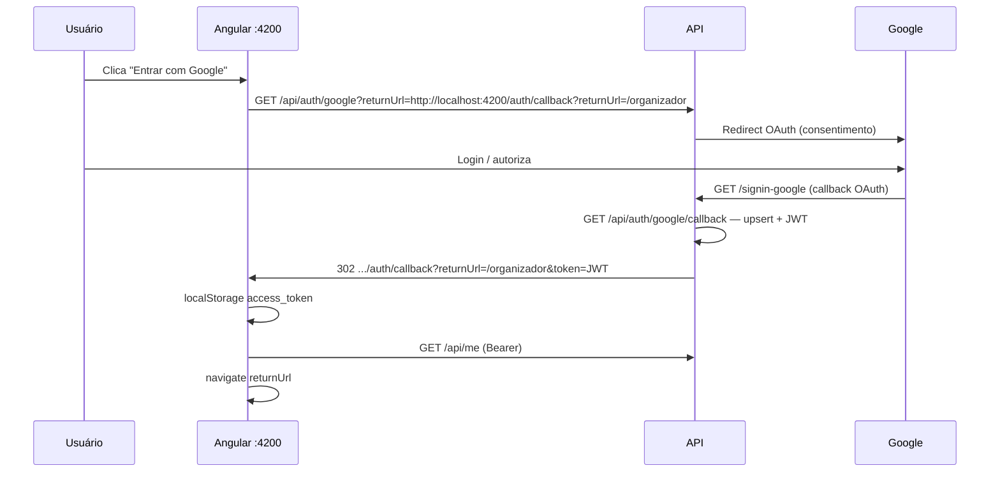

# Integração login Google — Backend ↔ Front Angular

Guia do fluxo **OAuth 2.0 Google** implementado no backend e como o **front-plataforma-esporte** (Angular) deve integrar.

> Contrato geral: `integracao-auth-backend.md`  
> Login e-mail/senha: `integracao-login-email-senha.md`

**Versão do documento:** 1.1 — alinhada ao código atual (Docker, status endpoint, dev organizer, `returnUrl` obrigatório).

---

## 1. O que foi implementado no backend

| Componente | Rota | Descrição |
|------------|------|-----------|
| Início OAuth | `GET /api/auth/google?returnUrl=...` | Valida `returnUrl`, redireciona o browser para Google |
| Callback Google (registrar no Console) | `GET /signin-google` | Chamado pelo Google após consentimento |
| Callback da aplicação | `GET /api/auth/google/callback` | Processa cookie OAuth, upsert usuário, JWT, redirect ao SPA |
| Status | `GET /api/auth/google/status` | `{ enabled, signInCallbackPath }` — útil para exibir/ocultar botão “Google” |

Constantes no código: `AuthConstants.GoogleSignInCallbackPath` = `/signin-google`; redirect interno pós-Google = `/api/auth/google/callback`.

### Regras de negócio

- **JWT é sempre da plataforma** — o front nunca usa o access token bruto do Google.
- **Novo usuário Google** (produção / padrão): roles iniciais **`Athlete`** apenas.
- **Desenvolvimento (`ASPNETCORE_ENVIRONMENT=Development`)**: e-mails em `Development:OrganizerEmails` recebem também **`Organizer`** após login Google (e o seed dev pode promover usuário já existente na subida da API). **Não** use essa lista em produção como substituto de RBAC real.
- **Mesmo e-mail** de conta e-mail/senha → vincula `GoogleSubjectId` (não duplica usuário).
- **`returnUrl`** deve ser URL **absoluta** cuja origem (`scheme://host:port`) está em **`Frontend:AllowedOrigins`** — anti open-redirect.
- **`returnUrl` vazio** → `400` com detalhe *"returnUrl é obrigatório."*
- Erro/cancelamento OAuth → redirect ao front com `?error=access_denied` (via `OnRemoteFailure` ou fluxo do callback).

### Docker Compose (referência)

- `env_file: .env` (opcional, `required: false`) — credenciais Google e JWT.
- Variáveis explícitas em `docker-compose.yml`: Mongo, CORS, `Frontend__AllowedOrigins__0`, JWT Issuer, opcionalmente `Development__OrganizerEmails__0`, etc.

---

## 2. Fluxo completo



### URL final de sucesso (exemplo)

```text
http://localhost:4200/auth/callback?returnUrl=/organizador&token=eyJhbGciOiJIUzI1NiIs...
```

### URL de erro (cancelamento ou falha)

```text
http://localhost:4200/auth/callback?returnUrl=/organizador&error=access_denied
```

---

## 3. Configurar Google Cloud Console

### Passo a passo

1. Acesse [Google Cloud Console](https://console.cloud.google.com/)
2. Crie um projeto (ou use existente)
3. **APIs e Serviços → Tela de consentimento OAuth**
   - Tipo: Externo
   - Modo **Teste** (dev) — adicione e-mails de teste (quem vai logar)
4. **APIs e Serviços → Credenciais → Criar credenciais → ID do cliente OAuth**
   - Tipo: **Aplicativo da Web**

### URIs de redirecionamento autorizados

Registre o callback da **API** (não do Angular):

| Cenário | `apiUrl` | URI de redirect no Google Console |
|---------|----------|-------------------------------------|
| Docker (porta host 5080) | `http://localhost:5080` | `http://localhost:5080/signin-google` |
| Local HTTPS | `https://localhost:5001` | `https://localhost:5001/signin-google` |

Use **exatamente** a URI da URL base em que a API está exposta ao browser.

### Origens JavaScript autorizadas (opcional)

Fluxo server-side: em geral não é obrigatório. Se o Console pedir:

```text
http://localhost:4200
```

### Guardar credenciais

Use **User Secrets** (local) ou **`.env`** na raiz (Docker; arquivo no `.gitignore`). Não commitar Client Secret.

---

## 4. Configurar credenciais no backend

### Opção A — User Secrets (`dotnet run`)

```powershell
cd src/BackPlataformaEsporte.Api

dotnet user-secrets set "Authentication:Google:ClientId" "SEU_CLIENT_ID.apps.googleusercontent.com"
dotnet user-secrets set "Authentication:Google:ClientSecret" "SEU_CLIENT_SECRET"
```

Ajuste também `Authentication:Jwt:Issuer` para bater com a URL da API (ex.: `https://localhost:5001` no perfil HTTPS).

### Opção B — arquivo `.env` na raiz (Docker)

Copie `.env.example` para `.env` e preencha (exemplo mínimo):

```env
Authentication__Google__ClientId=SEU_CLIENT_ID.apps.googleusercontent.com
Authentication__Google__ClientSecret=SEU_CLIENT_SECRET
Authentication__Jwt__Issuer=http://localhost:5080
Authentication__Jwt__Audience=front-plataforma-esporte
Authentication__Jwt__SigningKey=DEV_ONLY_min_32_chars_random_string!!
Frontend__AllowedOrigins__0=http://localhost:4200
```

**Opcional (dev) — e-mails que ganham role Organizer após login Google:**

```env
Development__OrganizerEmails__0=seu.email@gmail.com
# Development__OrganizerEmails__1=outro@exemplo.com
```

Ou em `appsettings.Development.json`:

```json
"Development": {
  "OrganizerEmails": [ "seu.email@gmail.com" ]
}
```

Reinicie:

```bash
docker compose up -d --build
```

### Verificar se o Google está habilitado

```bash
curl http://localhost:5080/api/auth/google/status
```

Resposta JSON (camelCase padrão ASP.NET Core):

```json
{
  "enabled": true,
  "signInCallbackPath": "/signin-google"
}
```

Se `enabled` for `false`, `ClientId`/`ClientSecret` não foram carregados.

---

## 5. Configuração do front Angular

### `environment.development.ts`

```typescript
export const environment = {
  production: false,
  apiUrl: 'http://localhost:5080',        // Docker — ou https://localhost:5001 (dotnet https)
  googleAuthPath: '/api/auth/google',
  credentialsLoginPath: '/api/auth/login',
  useAuthMock: false
};
```

**Sem barra final** em `apiUrl`.

### UX opcional — ocultar botão se Google desabilitado

```typescript
this.http.get<{ enabled: boolean; signInCallbackPath: string }>(
  `${environment.apiUrl}/api/auth/google/status`
).subscribe(s => this.googleLoginAvailable = s.enabled);
```

### Iniciar login Google (obrigatório: redirect do browser)

O front **não** deve usar `HttpClient` para iniciar o Google (não é JSON). Use **navegação full page**:

```typescript
loginWithGoogle(returnUrl: string): void {
  const callbackUrl =
    `${window.location.origin}/auth/callback?returnUrl=${encodeURIComponent(returnUrl)}`;
  const googleUrl =
    `${environment.apiUrl}${environment.googleAuthPath}?returnUrl=${encodeURIComponent(callbackUrl)}`;
  window.location.href = googleUrl;
}
```

**Exemplo de URL gerada:**

```text
http://localhost:5080/api/auth/google?returnUrl=http%3A%2F%2Flocalhost%3A4200%2Fauth%2Fcallback%3FreturnUrl%3D%252Forganizador
```

### `auth-callback.component.ts`

```typescript
ngOnInit(): void {
  const token = this.route.snapshot.queryParamMap.get('token');
  const error = this.route.snapshot.queryParamMap.get('error');
  const returnUrl = this.route.snapshot.queryParamMap.get('returnUrl') ?? '/';

  if (error || !token) {
    this.router.navigate(['/auth/login'], { queryParams: { error } });
    return;
  }

  localStorage.setItem('access_token', token);
  // Chamar GET /api/me com Authorization: Bearer, atualizar sessão, depois navigate(returnUrl)
}
```

### Após salvar o token

Igual ao login e-mail/senha:

```http
GET {apiUrl}/api/me
Authorization: Bearer {accessToken}
```

Resposta inclui `roles: string[]` (`Organizer`, `Athlete`). O guard de `/organizador` deve exigir `Organizer`.

---

## 6. Endpoints da API (resumo)

| Método | Rota | Auth |
|--------|------|------|
| `GET` | `/api/auth/google?returnUrl={url}` | Não |
| `GET` | `/api/auth/google/status` | Não |
| `GET` | `/signin-google` | Não (callback Google) |
| `GET` | `/api/auth/google/callback` | Não (interno pós-OAuth) |
| `GET` | `/api/me` | Bearer JWT |

**`GET /api/auth/google`**

| Parâmetro | Obrigatório | Descrição |
|-----------|-------------|-----------|
| `returnUrl` | Sim | URL absoluta do callback Angular (ex.: `http://localhost:4200/auth/callback?returnUrl=/organizador`) |

| Status | Significado |
|--------|-------------|
| `302` | Redirect para Google |
| `400` | `returnUrl` ausente ou não permitido |
| `503` | Google não configurado |

---

## 7. Escolha da URL da API e JWT Issuer

| Cenário | `apiUrl` no Angular | Redirect URI no Google | `Authentication:Jwt:Issuer` |
|---------|---------------------|--------------------------|----------------------------|
| Docker | `http://localhost:5080` | `http://localhost:5080/signin-google` | `http://localhost:5080` |
| Local HTTPS | `https://localhost:5001` | `https://localhost:5001/signin-google` | `https://localhost:5001` |

O **Issuer** do JWT deve ser a **mesma origem** que o front usa em `apiUrl` (validação `iss` no Bearer), senão `/api/me` falha com `401`.

---

## 8. Desenvolvimento — role Organizer por e-mail

Somente com `ASPNETCORE_ENVIRONMENT=Development`:

- Configuração: seção `Development` / variáveis `Development__OrganizerEmails__*`.
- Após login Google bem-sucedido, se o e-mail do Google estiver na lista, o usuário recebe **`Organizer`** (mantendo **`Athlete`**).
- **Produção:** não dependa disso; use fluxo formal de concessão de papel.

O front pode continuar usando o mesmo guard: verificar `roles` em `/api/me` ou claims `roles` no JWT.

---

## 9. Teste manual (sem front)

1. Credenciais Google + redirect URI corretos.
2. Abra no navegador (ajuste host/porta se necessário):

```text
http://localhost:5080/api/auth/google?returnUrl=http%3A%2F%2Flocalhost%3A4200%2Fauth%2Fcallback%3FreturnUrl%3D%252F
```

3. Complete o login no Google.
4. Esperado: redirect para `http://localhost:4200/auth/callback?...&token=...`  
   (Se o Angular não estiver rodando, a aba pode “falhar” — o importante é a URL na barra de endereços.)

5. Teste o token:

```powershell
$token = "COLE_O_TOKEN_DA_URL"
$headers = @{ Authorization = "Bearer $token" }
Invoke-RestMethod -Uri "http://localhost:5080/api/me" -Headers $headers
```

---

## 10. Checklist de integração (front)

- [ ] `useAuthMock: false`
- [ ] `apiUrl` sem barra final; igual ao host usado no Google redirect + JWT Issuer
- [ ] Botão Google usa `window.location.href` (não POST JSON)
- [ ] `returnUrl` no query da API é URL **absoluta** do callback Angular
- [ ] `auth-callback` lê `token` e `error`
- [ ] Salva `access_token` no `localStorage`
- [ ] Chama `GET /api/me` com `Authorization: Bearer`
- [ ] Guard `/organizador` exige `Organizer` em `roles`
- [ ] (Opcional) `GET /api/auth/google/status` para mostrar/ocultar botão

---

## 11. Problemas comuns

| Sintoma | Causa provável | Solução |
|---------|----------------|---------|
| `503` ao abrir `/api/auth/google` | Sem ClientId/Secret | User Secrets ou `.env` + rebuild |
| `redirect_uri_mismatch` | URI no Console ≠ `{apiUrl}/signin-google` | Corrigir no Google Cloud |
| `400 returnUrl não permitido` | Origem do `returnUrl` não está em `Frontend:AllowedOrigins` | Incluir `http://localhost:4200` |
| `400 returnUrl é obrigatório` | Query sem `returnUrl` | Sempre enviar parâmetro |
| `/api/me` 401 com token novo | Issuer ≠ `apiUrl` | Alinhar `Authentication:Jwt:Issuer` |
| `access_denied` na URL | Cancelamento OAuth ou falha remota | Tratar no callback; usuário teste no modo Teste |
| CORS | Não costuma afetar redirect full-page | Relevante para `fetch`/`HttpClient` em outras rotas |

---

## 12. Arquivos relevantes no backend

```
src/BackPlataformaEsporte.Api/
  Controllers/AuthController.cs
  Extensions/AuthServiceExtensions.cs
  Extensions/GoogleAuthConfigurator.cs
  Auth/AuthConstants.cs

src/BackPlataformaEsporte.Application/
  Auth/Google/GoogleSignInUseCase.cs

src/BackPlataformaEsporte.Infrastructure/
  Auth/GoogleAuthSettings.cs
  Auth/FrontendSettings.cs
  Auth/DevelopmentSettings.cs
  Auth/DevOrganizerPromoter.cs
  Persistence/MongoDb/Repositories/UserRepository.cs
  Persistence/MongoDb/DevUserSeeder.cs
```

---

**Versão:** 1.1 — maio/2026
